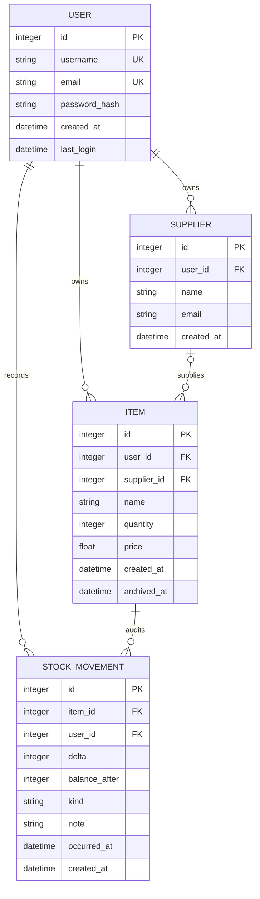
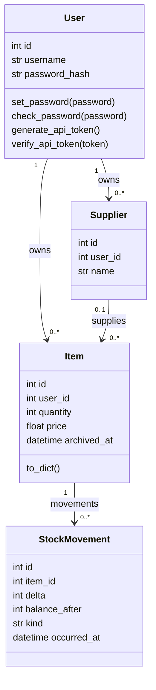

# Architecture

One Flask factory (`app.py`) registers inventory (`main.py`), authentication (`auth.py`), profile (`account.py`) and bearer API (`api.py`) blueprints. Jinja templates and local CSS render the responsive navy/teal UI without a JS build or CDN. Flask-Login manages sessions; Flask-WTF protects HTML mutations against CSRF. The bearer-only API does not accept session authentication.

`services/inventory.py` owns product validation and atomic quantity/ledger writes. SQLite is accessed through Flask-SQLAlchemy with foreign keys enabled for every connection. Alembic migrations run only via `init-db`. Products are archived rather than physically deleted. User-scoped queries and composite foreign keys protect tenant boundaries.

`services/demo.py` creates seeded, separate demonstration accounts. `services/ml.py` trains Gradient Boosting and Isolation Forest using CLI commands, persists artifacts, and exposes read-only inference. `services/llm.py` has no database imports and calls an optional CPU llama.cpp HTTP endpoint. It falls back to deterministic sentences.

The services are ordinary Python functions, not extra classes or running services. There are no background queues, Redis, Celery, Kubernetes or React dependencies. A small synchronous SQLite application is sufficient for this assignment.
